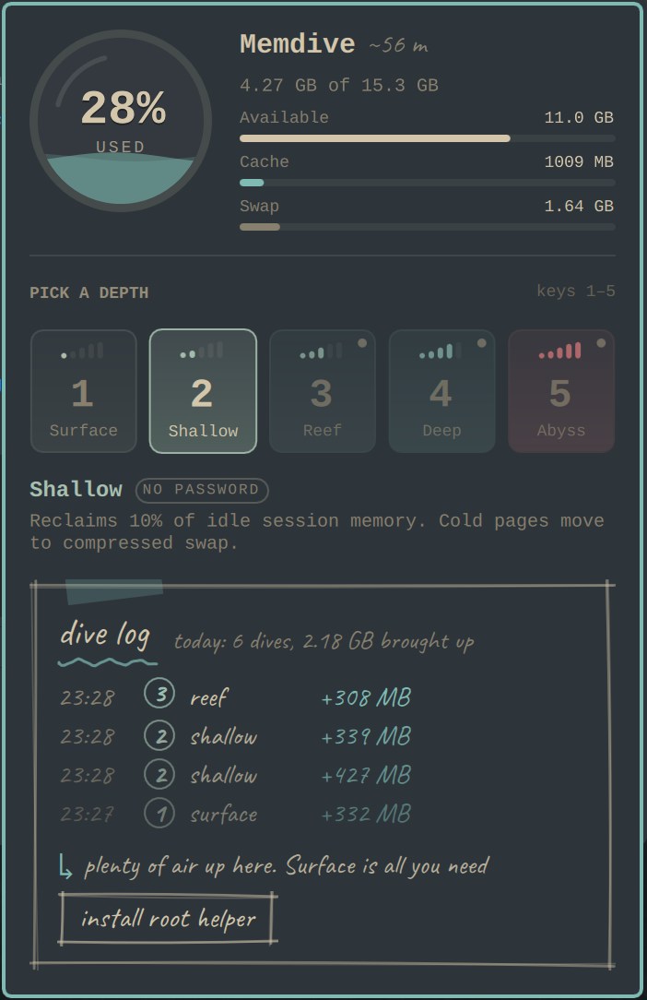

# Memdive

Free RAM in one click from the Omarchy bar. Pick a depth from **Surface** to
**Abyss**, watch the porthole drain, and keep a hand-drawn dive log of what
each run brought up.



## Install

```sh
omarchy plugin add https://github.com/arbabmujtaba/memdive.git --enable
```

A small ring appears in the bar showing how much memory is in use. Click it
to open the panel.

## Depths

| Depth | Name    | Password | What it does |
|-------|---------|----------|--------------|
| 1     | Surface | no       | Reclaims 20% of your session's file cache |
| 2     | Shallow | no       | Reclaims 10% of idle session memory; cold pages move to swap (zram, zswap or disk) |
| 3     | Reef    | helper   | Shallow, plus drops the kernel page, dentry and inode caches |
| 4     | Deep    | helper   | Reclaims 25% of session memory, drops caches, compacts RAM |
| 5     | Abyss   | helper   | Reclaims 50% of session and 25% of system services memory, drops caches, compacts |

Click a tile to run it. In the panel, `1`-`5` run a depth directly, `←`/`→`
and `Enter` pick one, and `Esc` closes. Middle-click the bar ring to repeat
the selected depth.

The **dive log** under the tiles lists your last runs, today's total, and a
hint for the current memory situation.

## How it works and what it touches

- **Depths 1-2 need no root.** They write to `memory.reclaim` in your own
  systemd user cgroup (`user@UID.service`), which systemd delegates to you.
  This needs cgroup v2 and Linux 5.19+. Linux 6.12+ lets Surface limit itself
  to file cache.
- **Depths 3-5 use a root helper.** The panel shows an **install root helper**
  button. It runs `helper/install.sh` once through `pkexec` (you'll be asked
  for your password), which installs:
  - `/usr/local/libexec/memdive-helper`, root-owned. It accepts only a single
    digit `1`-`5` and only writes `/proc/sys/vm/drop_caches`,
    `/proc/sys/vm/compact_memory` and `/sys/fs/cgroup/system.slice/memory.reclaim`.
  - `/usr/share/polkit-1/actions/io.github.arbabmujtaba.memdive.policy`, which
    lets the active local session run that helper without a password.
- **Swap safety.** Memdive never asks the kernel to push out more anonymous
  memory than half of your free swap. With no swap, only cache is freed.
- **Fallbacks.** On systems without cgroup reclaim (cgroup v1, older kernels,
  no delegation), every depth goes through the helper instead. Kernels without
  memory compaction skip that step.
- **History** is kept in `~/.local/state/memdive/history.jsonl` (last 50 runs).

Freed memory is room, not speed. Dropped caches are read back from disk and
swapped pages return when they're used, so Deep and Abyss can cause brief
stutters right after a run.

## Command line and keybindings

The same engine runs from a terminal and prints a JSON result:

```sh
~/.config/omarchy/plugins/io.github.arbabmujtaba.memdive/bin/memdive run 2
~/.config/omarchy/plugins/io.github.arbabmujtaba.memdive/bin/memdive caps   # what this machine supports
```

To run a depth from a keybinding (a notification shows the result):

```sh
omarchy-shell io.github.arbabmujtaba.memdive run 3
```

## Configure

Show the percentage next to the ring (horizontal bars only):

```sh
omarchy bar set io.github.arbabmujtaba.memdive showPercent true --json
```

Move it:

```sh
omarchy bar move io.github.arbabmujtaba.memdive --section right
```

## Remove

If you installed the root helper, remove it first:

```sh
pkexec bash ~/.config/omarchy/plugins/io.github.arbabmujtaba.memdive/helper/install.sh --uninstall
```

Then remove the plugin and, optionally, its history:

```sh
omarchy plugin remove io.github.arbabmujtaba.memdive
rm -rf ~/.local/state/memdive
```

## Requirements

Omarchy (Quattro shell), systemd, cgroup v2. `pkexec` (polkit) for depths 3-5.
Works on laptops and desktops, x86_64 and ARM (including Apple Silicon via
Asahi), with or without swap.

## License

MIT. The bundled handwriting font, [Caveat](https://github.com/googlefonts/caveat),
is licensed under the SIL Open Font License 1.1 (`assets/fonts/OFL.txt`).
